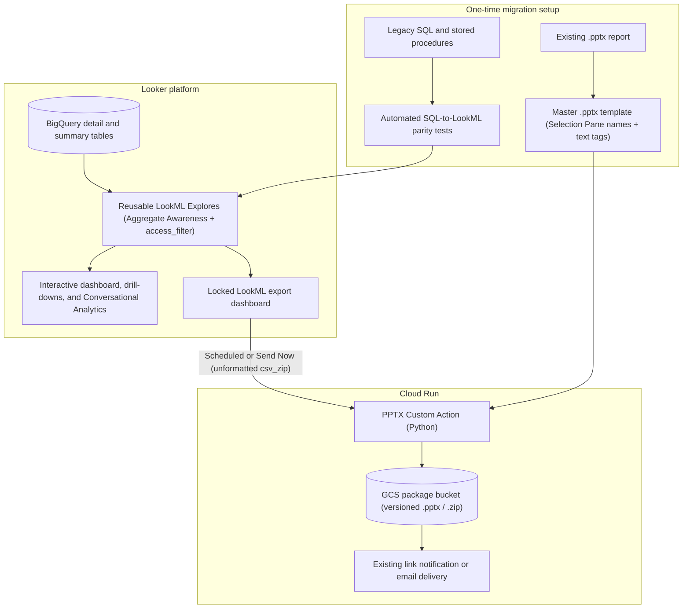

# Generating editable PowerPoint decks from Looker

Teams moving off legacy reporting pipelines often still need native Microsoft PowerPoint (`.pptx`) files at the end of a run. Static PDFs and chart screenshots work fine when nobody touches the deck, but they break down when consultants need to edit narrative callouts, adjust subgroup takeaways, or click "Edit Data" on native Office charts before meeting with a client. Desktop Excel add-ins linked to PowerPoint files have the opposite problem: someone still has to open Windows PowerPoint by hand to refresh COM links, which blocks unattended scheduling and breaks links when files are shared outside the network. Moving metric logic and scheduling into Looker while running a small PPTX Custom Action on Cloud Run lets Looker populate your existing PowerPoint templates directly.

## Architecture overview

## Consolidating legacy SQL into reusable LookML

Legacy reporting pipelines tend to accumulate dozens of stored procedures that write one summary table per slide. Copying those summary tables one-for-one into Looker creates model bloat and dead-end views that cannot slice by new dimensions or drill down to individual records.

During migration, we unwrap those procedural scripts into standalone `SELECT` queries and check row-for-row output parity against your current tables before cutting anything over. Where the underlying math is standard dimensional aggregation, we fold those queries into two or three shared LookML Explores over transaction-level snapshot tables rather than maintaining twenty-five separate views:

- LookML `aggregate_table` rollups pre-compute report summaries in BigQuery, clustered by account and period keys. Slide queries stay fast and inexpensive, and analysts still use the same metric definitions for live record-level outlier drill-downs and Looker Conversational Analytics.
- Row-level security runs through a Looker `access_filter` backed by a `Number Filter (advanced)` user attribute (`allowed_account_ids`). That attribute accepts a wildcard (`NOT NULL`) for internal analysts and comma-separated account IDs for restricted users, and keeps native `INT64` block pruning intact in BigQuery.
- Cross-period waterfall or variance tables that need fixed row scaffolds use Native Derived Tables (`explore_source`) built on top of the same core Explore. We save `create_process` persistent derived tables for genuine multi-statement scripts such as predictive model runs.

## Turning existing decks into reusable templates

Designers keep working directly in PowerPoint instead of rebuilding slides in code or maintaining a separate mapping file. Charts and slide tables match to Looker dashboard tiles through PowerPoint's built-in Selection Pane names; naming a chart `chart:regional_customers` connects it straight to the `regional_customers` tile. Dynamic titles, footers, and single-value callouts use plain `{{tile.column}}` text tags typed into PowerPoint text boxes, since native PowerPoint text boxes and slide tables cannot pull cells from an embedded Excel sheet on their own without Windows-only OLE image links.

Layout variants such as single-period versus two-period benchmark slides live as pre-sized slides inside the same master `.pptx`. At run time, the action drops whichever variant slides do not apply rather than recalculating column widths on merged table headers.

## Scheduling, delivery, and historical packages

Looker's built-in email scheduler only attaches formats Looker renders natively (PDF, PNG, or CSV). To output a `.pptx` straight from the Looker Dashboard Scheduler or an on-demand "Send Now" click, we register the PPTX Custom Action in Looker using the [Looker Action Hub API](https://github.com/looker-open-source/actions).

Two Looker dashboards sit on top of the same Explores: a clean interactive dashboard for human exploration and outlier drill-downs, and a Git-locked LookML export dashboard holding the exact data tiles needed by the PowerPoint deck, plus a one-row package metadata tile.

When a schedule runs, Looker evaluates all dashboard tiles under the recipient's permissions and pushes a single `unformatted` `csv_zip` archive over Private IP to the PPTX Custom Action. Sending raw numbers instead of pre-formatted currency strings lets `python-pptx` and `openpyxl` update both the PowerPoint chart XML cache and each chart's embedded `.xlsx` datasheet cleanly, so charts stay editable when someone clicks "Edit Data" in desktop PowerPoint while Office handles number formatting.

Once the deck is built, the PPTX Custom Action writes a timestamped package under that package ID to your GCS package bucket. If an existing bucket trigger or order tool already sends download links, nothing downstream changes; otherwise, the action emails the link directly. Saving each generated `.pptx` alongside its package ID lets consultants pull prior package states months later without overwriting manual narrative edits made to earlier drafts.
