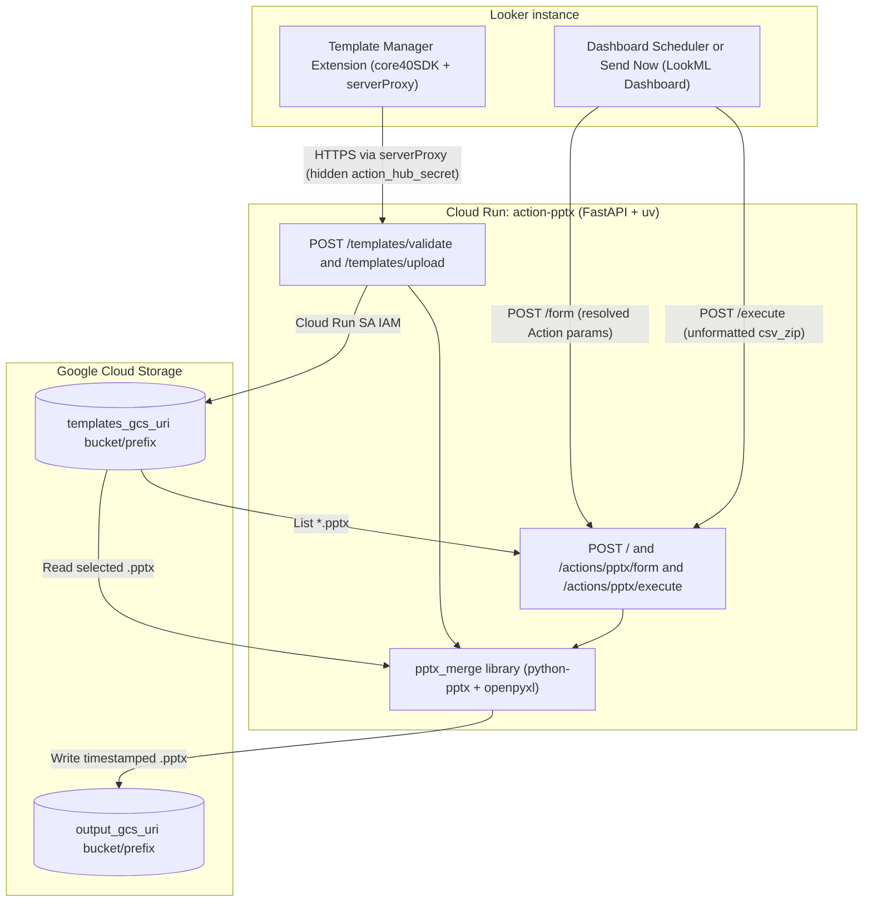

# Looker PowerPoint custom action (`action-pptx`)

Author: Bryan Weber  
Status: Proposed  
Date: 2026-11-12

## Overview

`action-pptx` is a Python Looker Action Hub service, companion CLI (`pptx_merge`), and lightweight Looker Template Manager Extension that populates native, editable Microsoft PowerPoint (`.pptx`) templates from scheduled Looker Dashboards.

Looker Admins configure `templates_gcs_uri` and `output_gcs_uri` once during Action registration (static `gs://bucket/prefix` values or mapped to Looker User Attributes for per-team folder isolation). Template authors name dynamic charts and tables in PowerPoint's Selection Pane and add `{{tile.column}}` text tags to match a LookML Dashboard, then validate and upload the `.pptx` straight from the Looker Template Manager Extension. When scheduling or sending a dashboard in Looker, users pick any uploaded `.pptx` from the Action Form dropdown; `action-pptx` receives Looker's `unformatted` `csv_zip` payload, fills text tags, tables, and editable Office charts, and writes a timestamped `.pptx` to `output_gcs_uri`.

## The problem

Teams delivering recurring client presentations from Looker hit three platform gaps:

1. Analysts and consultants often edit narrative callouts, add client-specific notes, or click *Edit Data* on native Office charts before presenting. Looker's built-in PDF and PNG exports flatten slides into static images, while desktop Excel-to-PowerPoint OLE links require someone to open Windows PowerPoint manually to refresh COM links, breaking unattended schedules and external sharing.
2. Looker's built-in email scheduler only attaches formats that Looker renders internally (`pdf`, `png`, `csv_zip`). Generating a `.pptx` from Looker's Dashboard Scheduler requires a custom Looker Action Hub integration receiving `csv_zip` (which caps each dashboard tile at 5,000 rows and omits LookML field metadata), leaving `.pptx` assembly, storage, and link delivery to the action service.
3. Non-technical template authors need a self-service way inside Looker to validate that a `.pptx` file's shapes and tags match a target Looker Dashboard before publishing it to the templates bucket, while preserving an immutable history of generated outputs so later scheduled runs never overwrite manual edits made to earlier drafts.

`action-pptx` closes these gaps across three small components: `pptx_merge` (a `uv`-managed Python library/CLI using `python-pptx` and `openpyxl`), a `FastAPI` Cloud Run service implementing both the Looker Action Hub endpoints (`/`, `/form`, `/execute`) and template management routes (`/templates/validate`, `/templates/upload`), and a single-screen Looker Extension that pairs `core40SDK` dashboard inspection with `extensionSDK.serverProxy` uploads.

## Goals

* Configure `templates_gcs_uri` and `output_gcs_uri` as Looker Action registration `params` (supporting static `gs://` prefixes or Looker User Attributes per team), and populate the Schedule Form's template `select` dropdown dynamically from `templates_gcs_uri`.
* Provide a Looker Template Manager Extension (with a one-time Admin `/config` route that auto-discovers Action Hub settings into Extension Context Data and stores `action_hub_secret` via `createSecretKeyTag`) that reads live LookML Dashboard schemas via `core40SDK` and calls `POST /templates/validate` and `POST /templates/upload` on Cloud Run.
* Bind slide elements directly inside PowerPoint by matching charts and tables through PowerPoint's Selection Pane names and replacing dynamic text via `{{tile.column}}` tags.
* Accept Looker Dashboard Scheduler and *Send Now* `unformatted` `csv_zip` webhooks in `action-pptx`, updating text tags, multi-header tables, `<c:chart>` XML caches, and embedded `ppt/embeddings/*.xlsx` sheets so desktop PowerPoint opens editable charts without repair prompts.
* Return an explicit error to Looker instead of saving a partially blank `.pptx` if a dashboard tile or column referenced by the template is missing from `csv_zip` or if a tile hits Looker's 5,000-row dashboard export limit.
* Write every generated `.pptx` to a timestamped path under `output_gcs_uri` so prior runs remain intact and new runs never overwrite edited drafts.
* Ship `pptx_merge` as a standalone `uv` Python CLI and library paired with a `SKILL.md` so local workflows and remote Python agents can also validate and populate `.pptx` decks.

## Non-goals

* Performing calculations, aggregations, or Excel formula evaluation inside `action-pptx` or embedded `.xlsx` sheets; incoming `csv_zip` tiles from Looker must be calculation-complete.
* Deleting or resizing columns dynamically inside merged PowerPoint tables at run time; layouts with different column structures use separate `.pptx` templates in `templates_gcs_uri`.
* Generating `.pptx` files inside the browser iframe itself (all `.pptx` parsing, validation, and compilation run in Python on Cloud Run or via the `pptx_merge` CLI).
* Syncing manual text or chart edits made inside PowerPoint back into Looker.

## Open questions

* On Private Service Connect (PSC) Looker Core instances, can `action-pptx`'s `*.a.run.app` hostname be allowlisted via PSC **Global FQDN** (Controlled Native Egress, where `extensionSDK.serverProxy` works out of the box), or do customer network rules mandate a private RFC1918 **Local FQDN** load balancer (where Looker blocks `serverProxy` on private IPs, requiring direct VPN browser `fetch` + OAuth for the Extension)?
* Once `action-pptx` writes a finished `.pptx` under `output_gcs_uri`, does an existing bucket trigger or external app already email the download link to recipients, or should `action-pptx` send link emails directly (and if directly, via SMTP or an API mailer such as SendGrid)?
* Do target customer templates contain any Office 2016+ Extended Chart XML (`ppt/charts/chartEx*.xml`, used by native Office waterfall, funnel, and treemap charts), and should `action-pptx` v1 include a `chartEx` XML updater or require standard `<c:chartSpace>` charts (such as stacked-column waterfalls)?
* Should the Action Form also allow bundling multiple templates into a single `.zip` output in GCS, or strictly one `.pptx` per scheduled plan?

## Critical user journeys

### Validating and uploading a `.pptx` template from the Looker Extension

Given an existing `.pptx` report being migrated (with a matching LookML Dashboard created alongside it) or a net-new `.pptx` built for an existing LookML Dashboard, an author names dynamic charts and tables in PowerPoint's Selection Pane to match dashboard tile titles and adds `{{tile.column}}` text tags to text boxes. The author opens the `action-pptx` Template Manager Extension in Looker, picks the target LookML Dashboard, and drops in the `.pptx` file. The Extension fetches the dashboard's tile and column schema via `core40SDK` and posts the `.pptx` plus schema through `extensionSDK.serverProxy` to Cloud Run's `/templates/validate` and `/templates/upload` routes, which verify OOXML compatibility and 1-to-1 tile/column parity before writing the `.pptx` into the user's `templates_gcs_uri` prefix.

### Generating an editable `.pptx` via Looker Dashboard Scheduler or Send Now

Given a Looker user opening *Schedule delivery* or *Send* on a LookML Dashboard, selecting `action-pptx` as the destination, choosing a validated template from the dropdown (populated from their `templates_gcs_uri`), and applying dashboard filters, Looker executes all dashboard tiles under the recipient's permissions as `unformatted` `csv_zip` and posts the payload to `action-pptx` on Cloud Run. `action-pptx` fills text tags, slide tables, `<c:chart>` XML caches, and embedded `.xlsx` datasheets, verifies chart XML-to-XLSX parity, and writes a timestamped `.pptx` under `output_gcs_uri` (triggering or sending the download link if configured). Opening the file in desktop PowerPoint displays formatted values and opens intact Excel sheets when clicking *Edit Data*.

### Preserving historical runs without overwriting manual edits

Given a consultant who downloaded an earlier `.pptx` draft to add custom narrative notes for a client meeting or needs to retrieve the exact deck generated six months ago, recurring schedules write each new run to a new timestamped object path under `output_gcs_uri`. Prior generated files remain untouched, and edited copies are never overwritten.

## Technical plan

### System architecture and data flow

`action-pptx` splits into three small components: a pure-Python template library and CLI (`pptx_merge`), a stateless `FastAPI` Cloud Run service (`action-pptx`), and a single-screen Looker Extension for self-service template validation and uploads.

### In-PPTX binding and formatting grammar (`pptx_merge`)

All data bindings live inside standard PowerPoint properties so template authors never maintain external mapping files. Because Looker's `DashboardZIPProducer` sanitizes each dashboard tile title into a lowercase filename (`dashboard-<dash_slug>/<tile_slug>.csv`, replacing spaces and punctuation with underscores), `pptx_merge` normalizes tile references using the exact same slug rule:

* Text tags (`{{tile_slug.column}}` or `{{tile_slug[row_index].column | fmt}}`) work inside any slide text box, title, footer, or fixed-layout PowerPoint table cell. Omitting `[row_index]` defaults to row `0`. Because PowerPoint often splits a typed `{{...}}` string across multiple XML `<a:r>` text runs during editing, `pptx_merge` resolves tags at the paragraph (`<a:p>`) level while preserving the first run's `<a:rPr>` font, size, and color properties. Built-in schedule tokens (`{{_plan.title}}`, `{{_plan.url}}`, `{{_plan.run_at}}`) inject schedule metadata.
* Inline format masks (`| <fmt>`) format raw primitives from `unformatted` `csv_zip` deterministically in Python without `eval`. Supported masks cover integer and decimal grouping (`#,##0`, `0.0`, `0.00`), currency (`$#,##0`, `$#,##0.00`), percentages (`0%`, `0.0%`, `0.00%`, scaling raw ratios by `100`), and ISO dates (`yyyy-mm-dd`). When a tag has no `| <fmt>` mask, strings and pre-formatted SQL columns pass through unchanged. Fixed-row comparison tables where rows in the same column mix counts, decimals, and percentages place row-indexed `{{tile_slug[i].col | fmt}}` tags directly inside each PowerPoint table cell.
* Dynamic N-row slide tables are tagged in PowerPoint's Selection Pane as `table:<tile_slug>`. The last row of the template table acts as a prototype row (carrying optional `{{.column | fmt}}` cell masks and `<a:tcPr>` border/fill styles); `pptx_merge` clones that prototype XML row once per CSV record and removes the prototype row.
* Native Office charts are tagged in PowerPoint's Selection Pane as `chart:<tile_slug>`. Column `0` of `<tile_slug>.csv` supplies category labels and columns `1..K` supply numeric series (`float` values parsed directly from `unformatted` `csv_zip`, mapping empty cells to `None`). Calling `chart.replace_data(CategoryChartData)` in `python-pptx` rewrites both `ppt/charts/chartN.xml` (`<c:strCache>`, `<c:numCache>`, and `<c:f>` sheet range formulas) and the embedded `ppt/embeddings/Microsoft_Excel_WorksheetN.xlsx` file while keeping the template chart's series colors, axes, and `<c:formatCode>` number formats intact. After mutation, `pptx_merge` opens each updated embedded `.xlsx` with `openpyxl` to verify that cached XML point counts and values match the worksheet cells before returning bytes.

### Cloud Run HTTP API contract (`action-pptx`)

`action-pptx` runs on Python 3.12+ and `FastAPI` (managed with `uv`) behind `--no-invoker-iam-check`, since neither Looker `OutgoingWebhook` nor `ExternalApiProxy` attaches Google OIDC bearer tokens. Action Hub routes (`/actions/pptx/*`) verify `Authorization: Token token="<ACTION_HUB_SECRET>"` using `hmac.compare_digest`. Extension routes (`/templates/*`) accept either `Authorization: Token token="<ACTION_HUB_SECRET>"` (injected server-side via `extensionSDK.serverProxy` and `createSecretKeyTag`) or `Authorization: Bearer <google_oauth_token>` (bypassing `ACTION_HUB_SECRET` when OAuth mode is used). Every route checks `gs://` URIs against an `ALLOWED_GCS_BUCKETS` environment allowlist and path-traversal sanitizer.

| Endpoint | Caller | Request summary | Response / behavior |
| :--- | :--- | :--- | :--- |
| `GET /healthz` | Cloud Run probe | None | Verifies configuration is loaded and returns `200 OK`. |
| `POST /` | Looker Admin | Action Hub discovery payload | Returns integration definition (`name: "action-pptx"`, `supported_action_types: ["dashboard"]`, `supported_formats: ["csv_zip"]`, `supported_formattings: ["unformatted"]`, `supported_download_settings: ["push"]`) and registration `params` (`templates_gcs_uri`, `output_gcs_uri`). |
| `POST /actions/pptx/form` | Looker Schedule modal | `{ data: { templates_gcs_uri, output_gcs_uri }, form_params }` | Lists `*.pptx` objects under `templates_gcs_uri` via Cloud Run Service Account IAM and returns `ActionForm` fields: required `template` (`select`) and optional `filename_prefix` (`string`). |
| `POST /actions/pptx/execute` | Looker Scheduler | `{ scheduled_plan, data, form_params, attachment: { data (base64 zip) } }` | Unpacks `csv_zip` in memory, downloads `form_params.template` from `templates_gcs_uri`, runs `pptx_merge`, writes `<output_gcs_uri>/<prefix>_<utc_ts>_<webhook_id>.pptx`, runs optional link-notification hook, and returns `{ looker: { success: true } }` (or `success: false` with a diagnostic message if any referenced tile/column is missing, duplicates collide as `tile_1.csv`, or a referenced tile hits 5,000 rows). |
| `POST /templates/validate` | Looker Extension | `{ filename, pptx_base64, dashboard_tiles: [{ title, slug, columns }] }` | Accepts `Token` or Google OAuth `Bearer` auth. Runs `pptx_merge.inspect_and_validate()` in memory; reports discovered Selection Pane bindings, `{{...}}` tags, any unsupported `ppt/charts/chartEx*.xml` charts, and any missing tile or column mismatches against `dashboard_tiles`. |
| `POST /templates/upload` | Looker Extension | Same as `/templates/validate` plus `templates_gcs_uri` | Accepts `Token` or Google OAuth `Bearer` auth. Runs full validation; if zero errors, writes `<filename>.pptx` to `templates_gcs_uri` (via Cloud Run Service Account IAM, or caller OAuth token if GCS pass-through is enabled) and returns the object URI and binding summary. |

### Looker Template Manager Extension, `/config` setup, and Private IP networking

In Looker's Core API, `GET /api/4.0/integrations/:id` masks `param.value` as `null` for non-admin users, and `GET /api/4.0/integration_hubs/:id` marks `authorization_token` unreadable (`readable: false`) for all users including Admins. To avoid requiring Admin permissions for everyday template authors and avoid extra user attributes for bucket paths, the Extension (`extension/`) includes an Admin-only `/config` setup route alongside the main upload view:

* When a Looker Admin opens `/config` once after registering the Action Hub, the Extension calls `core40SDK.all_integration_hubs()` and `core40SDK.all_integrations()` to auto-discover and pre-fill the `action-pptx` Cloud Run URL and `templates_gcs_uri` (static value or mapped `user_attribute_name`) from the registered Action. Saving `/config` persists those non-secret settings into shared Extension Context Data (`extensionSDK.saveContextData`, readable by all Extension users) and stores the Action Hub secret in a single hidden scoped user attribute (`action_hub_secret`, `value_is_hidden: true`, domain-allowlisted to the Cloud Run host) so `manifest.lkml` only declares `scoped_user_attributes: ["action_hub_secret"]`.
* On **Global FQDN** Private Service Connect (PSC) or public Looker Core instances, the Extension calls `/templates/validate` and `/templates/upload` through `extensionSDK.serverProxy` with `Authorization: Token token="${extensionSDK.createSecretKeyTag("action_hub_secret")}"`, matching the exact token header checked on Action Hub webhooks.
* On strict RFC1918 **Local FQDN** PSC deployments (`10.x.x.x`), Looker's `serverProxy` rejects private IPs (`createSecretKeyTag` cannot be used on browser `fetch` calls). Instead, the Admin enables Google OAuth mode on `/config` (storing a Web OAuth Client ID in Context Data). Template authors sign in via `extensionSDK.oauth2Authenticate` and the browser `fetch`es `/templates/*` over corporate VPN with `Authorization: Bearer <access_token>`, bypassing `ACTION_HUB_SECRET`. Because Cloud Run runs with `--no-invoker-iam-check`, users need zero Cloud Run IAM roles (`roles/run.invoker` is not used); OAuth only needs `openid email` scopes when Cloud Run verifies the user's Google domain (`ALLOWED_OAUTH_DOMAINS`) and writes via the Cloud Run Service Account (or adds scope `https://www.googleapis.com/auth/devstorage.read_write` plus `roles/storage.objectUser` on the bucket if per-user GCS IAM enforcement is desired).

### Memory sizing and operational logging

Cloud Run HTTP/1.1 enforces a hard 32 MiB inbound request ceiling (~24 MiB max compressed `csv_zip` prior to base64 encoding), and Looker caps dashboard exports at 5,000 rows per tile. Base `FastAPI`, `lxml`, and `openpyxl` consume roughly 120 MiB RSS, and a large 50-slide merge peaks at ~150 to 350 MiB of transient heap (decoded CSV rows, `.pptx` zip buffers, and chart `.xlsx` sheets closed per chart). Sizing Cloud Run at `2 vCPU / 2 GiB RAM` with `--concurrency=2` caps worst-case two-request memory near ~820 MiB (leaving >1 GiB headroom; raising `--concurrency` above `4` requires bumping RAM to `4 GiB`). Structured JSON logs written to stdout record `logging.googleapis.com/trace`, `webhook_id`, `scheduled_plan_id`, `template`, tile counts, and per-tile row counts while redacting all CSV cell values and auth headers.

## Alternatives considered

### Looker native PDF schedules and Excel OLE-linked PowerPoint decks

Using Looker's built-in 16:9 widescreen PDF scheduler or linking desktop PowerPoint files to Excel workbooks refreshed via the Looker Excel Connector requires zero custom Cloud Run infrastructure. However, PDF exports flatten slides into static images that prevent editing callout text or chart data, while Excel-to-PowerPoint OLE links require interactive desktop sign-in and manual Windows PowerPoint COM link refreshes that fail unattended schedules and break when shared externally. Rejected by author: consultants must edit narrative text boxes, subgroup callouts, and native PowerPoint chart data sheets after delivery.

### Node.js PPTX libraries and forking the Node.js Action Hub

Implementing the action in TypeScript on top of the existing `looker-open-source/actions` Node.js server would reuse code from sibling actions. In practice, `PptxGenJS` can only generate new slides from scratch and cannot open or edit existing `.pptx` templates, `pptx-automizer` lacks `python-pptx`'s `chart.replace_data()` reliability across combo charts, number formats, and merged tables, and forking the legacy Node Action Hub carries roughly 4,000 lines of deprecated dependencies (`request`, `raven`, and child-process IPC Buffer copies). Rejected by author: Python `uv` with `FastAPI`, `python-pptx`, and `openpyxl` implements the three Looker Action Hub routes cleanly with mature chart and `.xlsx` mutation.

### Client-side `.pptx` compilation inside a browser Dashboard Tile Extension

Generating `.pptx` files directly inside a Looker Dashboard Tile Extension using `core40SDK` (`json_detail`) avoids running a backend service for interactive downloads. However, `python-pptx` does not run in browsers (forcing custom TypeScript XML surgery on `<c:chart>` and embedded `.xlsx` files), multi-chart decks spike browser tab memory by 300 to 600 MiB, browser downloads bypass GCS history archival, and browser tiles still cannot execute headless Looker Dashboard Scheduler cron jobs. Rejected by author: running `.pptx` compilation in Python on Cloud Run handles both scheduled and *Send Now* runs through one code path, keeping the Looker Extension scoped strictly to template validation and upload.

### Cloud Run environment variables or interactive Form folder pickers for GCS paths

Hardcoding `GCS_TEMPLATES_URI` and `GCS_OUTPUT_URI` as Cloud Run environment variables avoids Looker Admin parameter setup, while rendering `interactive: true` folder pickers on the Schedule Form lets users choose folders per schedule. Hardcoded environment variables require redeploying Cloud Run to change buckets and prevent per-team isolation, whereas interactive folder pickers trigger extra synchronous `/form` round-trips inside Looker's Schedule modal and expose bucket paths to every scheduler user. Rejected by author: declaring `templates_gcs_uri` and `output_gcs_uri` as Action registration `params` allows Looker Admins to configure static `gs://` prefixes or per-team Looker User Attributes while keeping the Schedule Form down to a single template dropdown.

### Direct GCS Console uploads or Git CI pipelines instead of the Template Manager Extension

Skipping `/templates/*` routes and relying on Google Cloud Console uploads (with local `pptx_merge` CLI checks) or a Git-to-GCS CI pipeline removes the Looker Extension from scope. Direct Console uploads require granting GCP Console access to non-technical presentation designers and allow unvalidated `.pptx` files into the bucket, while Git pipelines require submitting pull requests for binary `.pptx` edits. Rejected by author: a small Looker Extension validates `.pptx` shapes and tags against live LookML Dashboards inside Looker before uploading to GCS.

### Requesting `formatted` `csv_zip` payloads and parsing strings for charts

Setting `supported_formattings: ["formatted"]` populates `{{tile.column}}` text tags and slide table cells with Looker's formatted strings (`"$34,855,339"`, `"55.7%"`) without inline format masks. However, `formatted` `csv_zip` rounds chart numbers to display precision (`0.5568` becomes `"55.7%"`, parsed as `0.557`) and fails whenever a chart binds to a measure with non-numeric display prefixes or suffixes. Rejected by author: requesting `unformatted` `csv_zip` preserves exact floating-point precision for `<c:chart>` caches and `.xlsx` sheets while `{{tile.col | fmt}}` masks format text and table values explicitly.

## Detailed implementation

### Target files to create

All paths below are relative to the project root.

#### `./pyproject.toml` (create)

Defines the Python 3.12+ `uv` workspace, build backend (`hatchling`), CLI entrypoint (`pptx-merge = "pptx_merge.cli:main"`), runtime dependencies (`fastapi`, `uvicorn[standard]`, `python-pptx`, `openpyxl`, `google-cloud-storage`, `google-auth`, `requests`), and development dependencies (`pytest`, `httpx`, `ruff`, `ty`), along with `[tool.ruff]` and `[tool.ty]` configuration. Needed so both the standalone `pptx_merge` CLI and the `action_pptx` Cloud Run service share one lockfile (`uv.lock`) without `pip` or `poetry`.

#### `./src/pptx_merge/__init__.py` (create)

Exports the public library types (`TileSchema`, `SlideBinding`, `ValidationIssue`, `DeckValidationReport`, `MergeResult`, `MergeError`) and top-level functions (`sanitize_tile_slug`, `inspect_and_validate`, `merge_pptx`). Needed to keep a clean boundary between pure-Python OOXML processing and FastAPI HTTP transport so local CLI callers, tests, and Cloud Run call the exact same entrypoints.

#### `./src/pptx_merge/formatter.py` (create)

Implements `sanitize_tile_slug(title: str) -> str` matching Looker's `DashboardZIPProducer` filename rule (`re.sub(r"(^\.+$)|[/?*\\:|\"<>\s%]", "_", title).lower()`) and `format_value(raw: str | None, mask: str | None) -> str` supporting deterministic format masks (`#,##0`, `0.0`, `0.00`, `$#,##0`, `$#,##0.00`, `0%`, `0.0%`, `0.00%` scaling raw ratios by `100`, and `yyyy-mm-dd`) without `eval`. Needed so `unformatted` `csv_zip` primitives render identically across text boxes and slide table cells.

#### `./src/pptx_merge/inspector.py` (create)

Implements `inspect_and_validate(pptx_bytes: bytes, dashboard_tiles: list[TileSchema] | None = None) -> DeckValidationReport`. Walks all slides and nested `<p:grpSp>` group shapes in `python-pptx`, extracts `chart:<tile_slug>` and `table:<tile_slug>` Selection Pane bindings plus paragraph-level `{{tile_slug[i].column | fmt}}` tags, inspects package relationships for unsupported Office 2016+ Extended Chart XML parts (`ppt/charts/chartEx*.xml`), detects duplicate dashboard tile titles that Looker would rename `<slug>_1.csv`, and verifies every referenced `tile_slug` and column header against `dashboard_tiles` when supplied. Needed by both `pptx-merge validate` and Cloud Run's `/templates/validate` and `/templates/upload` routes.

#### `./src/pptx_merge/engine.py` (create)

Implements `merge_pptx(pptx_bytes: bytes, csv_zip_bytes: bytes, plan_meta: dict[str, str]) -> MergeResult`. Unpacks `csv_zip` in memory with a strict uncompressed byte cap, rejects Looker's access-denied tile sentinel (`"You do not have access to this data..."`), raises `MergeError` when any referenced tile or column is missing or when a referenced tile reaches Looker's 5,000-row dashboard export ceiling, resolves `{{...}}` tags at `<a:p>` paragraph level while preserving the first `<a:r>` run's `<a:rPr>` font styling, clones `table:<tile_slug>` prototype rows, updates `chart:<tile_slug>` shapes via `CategoryChartData` (`float` series values with blanks mapped to `None`), and re-opens each modified `ppt/embeddings/*.xlsx` workbook with `openpyxl` to assert XML `<c:numCache>` / `<c:strCache>` parity against worksheet cells. Needed to guarantee that desktop PowerPoint opens populated decks and *Edit Data* sheets without repair prompts or partial blank slides.

#### `./src/pptx_merge/cli.py` (create)

Implements the `argparse` command-line interface exposing `inspect <deck.pptx>`, `validate <deck.pptx> (--schema <tiles.json> | --csv-zip <export.zip>)`, and `merge <deck.pptx> --csv-zip <export.zip> -o <out.pptx>`, emitting structured JSON reports to stdout and non-zero exit codes on validation or merge failures. Needed for local developer testing, CI checks, and agent skill workflows without running FastAPI.

#### `./src/action_pptx/__init__.py` and `./src/action_pptx/config.py` (create)

Loads environment settings (`ACTION_HUB_SECRET`, `PUBLIC_BASE_URL`, `ALLOWED_GCS_BUCKETS`, `ALLOWED_OAUTH_DOMAINS`, `OAUTH_GCS_PASSTHROUGH`, and optional notification webhook or SMTP variables), implements constant-time `Authorization: Token token="..."` verification (`hmac.compare_digest`) plus Google OAuth `Bearer` verification (`google.oauth2.id_token` / tokeninfo domain check against `ALLOWED_OAUTH_DOMAINS`), validates `gs://` prefixes against `ALLOWED_GCS_BUCKETS` while rejecting `..` path segments, and configures structured JSON stdout logging (`logging.googleapis.com/trace`) that redacts CSV cell values and auth headers. Needed to enforce authentication, bucket isolation, and safe logging on a `--no-invoker-iam-check` Cloud Run service.

#### `./src/action_pptx/gcs.py` (create)

Wraps `google-cloud-storage` with four small helpers: `list_pptx_templates(gcs_uri)`, `download_template_bytes(gcs_uri, filename)`, `upload_template_bytes(gcs_uri, filename, data, oauth_token=None)`, and `write_timestamped_output(gcs_uri, prefix, webhook_id, data)`. Uses Cloud Run Application Default Credentials by default, or caller `google.oauth2.credentials.Credentials` on `/templates/upload` when `OAUTH_GCS_PASSTHROUGH=true`. Needed to isolate GCS I/O and keep timestamped output paths immutable.

#### `./src/action_pptx/app.py` (create)

Defines the stateless `FastAPI` application and Pydantic request/response schemas for `GET /healthz`, `POST /` (Action Hub discovery returning `supported_action_types: ["dashboard"]`, `supported_formats: ["csv_zip"]`, `supported_formattings: ["unformatted"]`, `supported_visualization_formattings: ["apply"]`, `supported_download_settings: ["push"]`, and `params: [templates_gcs_uri, output_gcs_uri]`), `POST /actions/pptx/form`, `POST /actions/pptx/execute`, `POST /templates/validate`, and `POST /templates/upload`. Needed to bridge Looker's Action Hub webhook protocol and the Template Manager Extension to `pptx_merge` and GCS.

#### `./Dockerfile` (create)

Builds a minimal `python:3.12-slim` container image using `uv sync --frozen --no-dev`, drops root privileges, and launches `uvicorn action_pptx.app:app --host 0.0.0.0 --port 8080` for Cloud Run (`2 vCPU`, `2 GiB RAM`, `--concurrency=2`, `--timeout=540s`, `--no-invoker-iam-check`). Needed for repeatable Cloud Run deployments.

#### `./extension/manifest.lkml` (create)

Declares the standalone Looker Extension (`mount_points: { standalone: yes }`) with `core_api_methods: ["me", "search_dashboards", "dashboard", "lookml_model_explore", "merge_query", "all_integration_hubs", "all_integrations", "all_user_attributes", "create_user_attribute", "set_user_attribute_group_values"]`, `scoped_user_attributes: ["action_hub_secret"]`, `external_api_urls` for Cloud Run and `https://oauth2.googleapis.com`, and `oauth2_urls: ["https://accounts.google.com/o/oauth2/v2/auth"]`. Needed because Looker's Extension Host blocks any Core SDK call, `serverProxy` request, or OAuth flow not declared in `manifest.lkml`.

#### `./extension/package.json`, `./extension/tsconfig.json`, and `./extension/webpack.config.js` (create)

Configures TypeScript and Webpack to compile the React 18 Extension (`@looker/extension-sdk`, `@looker/sdk`) into a single `bundle.js` asset for Looker project upload. Needed to build and bundle the Looker Extension with minimal frontend dependencies.

#### `./extension/src/dashboardSchema.ts` (create)

Uses `LookerExtensionSDK.createClient(extensionSDK)` to load `dashboard(id)`, caches `lookml_model_explore(model, view)` responses per distinct Explore (plus `merge_query` for merged-result tiles) without running warehouse SQL queries, filters out `vis_config.hidden_fields` and `hidden_points_if_no`, and computes each tile's `sanitizeTileSlug(title)` and exact `csv_zip` column headers matching Looker's `StreamerVisConfig` (`vis_config.series_labels[name] ?? ((vis_config.show_view_names ?? true) ? field.label : field.label_short) ?? field.label`). Needed so `/templates/validate` checks template bindings against the exact CSV filenames and column headers Looker's scheduler produces.

#### `./extension/src/ConfigPage.tsx` (create)

Implements the Admin `/config` route: queries `all_integration_hubs()` and `all_integrations()` to auto-discover and pre-fill the Cloud Run URL and `templates_gcs_uri` (static `gs://` prefix or mapped `user_attribute_name`), saves non-secret config into `extensionSDK.saveContextData`, creates or updates the hidden `action_hub_secret` scoped user attribute, and configures optional Google OAuth mode (Web OAuth Client ID and GCS pass-through toggle) for RFC1918 `Local FQDN` instances. Needed so everyday template authors never need Looker Admin permissions or manual URL entry.

#### `./extension/src/App.tsx` and `./extension/src/index.tsx` (create)

Connects to the Looker host via `connectExtensionHost`, routes `/config` to `ConfigPage`, and renders the main Template Manager view where authors pick a LookML Dashboard, drop a `.pptx` file, review validation diagnostics from `POST /templates/validate` (sending `extensionSDK.createSecretKeyTag("action_hub_secret")` via `serverProxy`, or `Authorization: Bearer` via `oauth2Authenticate` + `fetch` in OAuth mode), and upload clean templates via `POST /templates/upload`. Needed to give non-technical authors self-service `.pptx` validation and publishing inside Looker.

#### `./skills/pptx-merge/SKILL.md` (create)

Documents PowerPoint Selection Pane naming (`chart:<tile_slug>`, `table:<tile_slug>`), `{{tile_slug[i].column | fmt}}` syntax, supported format masks, and `uv run pptx-merge` (`inspect`, `validate`, `merge`) commands. Needed so local developers and AI coding agents can author, audit, and populate `.pptx` decks directly from the CLI.

#### `./tests/conftest.py`, `./tests/test_pptx_merge.py`, and `./tests/test_action_pptx.py` (create)

Builds synthetic `.pptx` and `csv_zip` fixtures in memory (split-run `{{...}}` text boxes, fixed-row multi-format tables, dynamic `table:<slug>` prototype rows, native `<c:chart>` workbooks, and simulated `ppt/charts/chartEx1.xml` parts) and tests `formatter.py`, `inspector.py`, `engine.py` (including post-merge `openpyxl` XML-to-XLSX parity, missing tile/column errors, 5,000-row cap errors, duplicate `tile_1.csv` collisions, and Looker access-denied sentinel rejection), and `app.py` (`httpx.AsyncClient` tests for `/`, `/form`, `/execute`, `/templates/validate`, `/templates/upload`, `Token` vs. `Bearer` auth, and `ALLOWED_GCS_BUCKETS` path checks). Needed to verify every OOXML mutation and failure boundary automatically without external Looker or GCS dependencies.

#### `./README.md` (create)

Documents Cloud Run deployment flags, Looker Action Hub registration, one-time Extension `/config` setup, Private IP (`Global FQDN` vs. `Local FQDN`) setup, and PowerPoint template authoring rules. Needed for operators deploying `action-pptx` and analysts tagging templates.

### Verification plan

* Python static analysis and type checking: `uv run ruff check .`, `uv run ruff format --check .`, and `uv run ty check` must pass with zero errors.
* Python unit and integration test suite: `uv run pytest` must pass across `tests/test_pptx_merge.py` and `tests/test_action_pptx.py`, asserting 100% XML `<c:numCache>` / `<c:strCache>` parity against embedded `openpyxl` `.xlsx` cells on mutated charts and explicit failure responses on missing tiles, missing columns, access-denied tiles, and 5,000-row cap hits.
* CLI smoke check: `uv run pptx-merge inspect`, `validate`, and `merge` executed against generated `.pptx` + `csv_zip` fixtures must exit `0` on valid inputs and exit non-zero with structured JSON diagnostics on broken bindings or `chartEx` charts.
* Extension build and type check: `npm --prefix extension run typecheck` (`tsc --noEmit`) and `npm --prefix extension run build` must produce `extension/dist/bundle.js` cleanly.
* Desktop PowerPoint round-trip check: opening a merged `.pptx` output in Microsoft PowerPoint and clicking *Edit Data* on a populated `chart:<tile_slug>` shape must open the embedded Excel datasheet with updated rows and series without triggering a file-repair prompt.

*Drafted with EGM*
